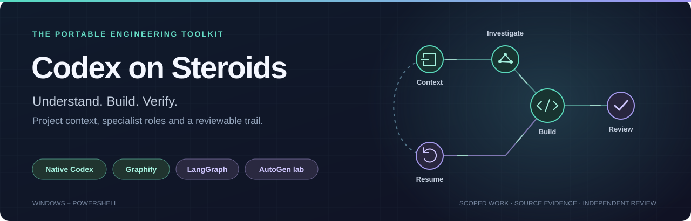
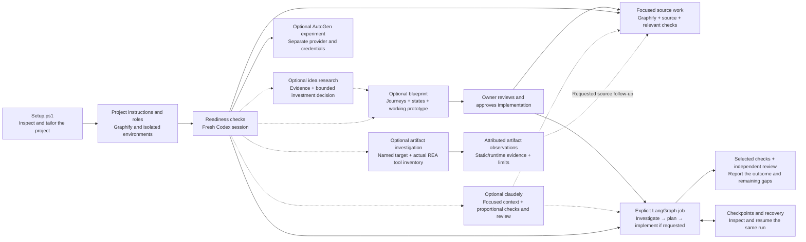

# Codex on Steroids

<p align="center">
  
</p>

<p align="center"><strong>Give Codex a project-aware engineering workflow, with evidence you can review.</strong></p>

<p align="center">Windows + PowerShell &nbsp; | &nbsp; Graphify &nbsp; | &nbsp; LangGraph &nbsp; | &nbsp; AutoGen experiment lab</p>

<p align="center">
  <a href="#quick-start">Get started</a> &nbsp; · &nbsp;
  <a href="#how-it-works">See the workflow</a> &nbsp; · &nbsp;
  <a href="#optional-modules">Explore optional modules</a> &nbsp; · &nbsp;
  <a href="#graphify-and-existing-tools">Explore Graphify</a> &nbsp; · &nbsp;
  <a href="payload/dev-docs/engineering-automation/portable-guide.md">Read the guide</a> &nbsp; · &nbsp;
  <a href="VERIFICATION.md">Check the evidence</a>
</p>

**Codex on Steroids** is a portable Windows engineering toolkit for existing projects. One setup command inspects your project, runs read-only Codex onboarding, installs project instructions and specialist roles, and installs or reuses Graphify to consult a real code graph. When a task needs a durable team, start the LangGraph coordinator explicitly and keep its plans, checks, reviews and checkpoints together.

| Understand the project | Coordinate the work | Review the outcome |
|---|---|---|
| Tailored project context and Graphify relationships, checked against current source. | Six engineering roles, scoped assignments and a persistent LangGraph coordinator. | Selected validation checks, an independent reviewer and explicit unmet criteria. |

Use it for focused Codex work, a durable engineering job, or a separate AutoGen experiment. Add optional modules to research an idea, review an experience before implementation, apply selected Claude Code practices with `claudely`, or investigate a named shipped artifact with `reverse-engineer-anything`. Setup supplies the tooling; you choose which route to start.

## Quick start

You need **Windows PowerShell**, **Python 3.11+**, **Git**, and the **Codex CLI signed into your existing account**. The VS Code extension alone does not guarantee the `codex` terminal command is installed. Confirm the CLI before setup:

```powershell
codex --version
codex login status
```

**1. Clone the toolkit and install it into an existing project.**

```powershell
git clone https://github.com/ichillous/codex-on-steroids.git C:\Toolkits\engineering-starter-kit
& 'C:\Toolkits\engineering-starter-kit\Setup.ps1' -ProjectRoot 'C:\Projects\MyApp'
```

Replace `C:\Projects\MyApp` with your project root. Default setup runs an onboarding model turn using your configured Codex model/account and downloads dependencies into local tooling environments. Existing native permissions, trust and account settings still apply.

If you prefer to keep the toolkit inside the destination project, copy the entire folder there as `engineering-starter-kit` and run:

```powershell
.\engineering-starter-kit\Setup.ps1
```

Without `-ProjectRoot`, the destination is the folder containing the kit, regardless of your terminal's current directory. For a missing graph in a large project, select the initial source scope explicitly:

```powershell
& 'C:\Toolkits\engineering-starter-kit\Setup.ps1' -ProjectRoot 'C:\Projects\MyApp' -GraphifyScope 'backend/src','frontend/src'
```

**2. Inspect readiness from the destination project.**

Read the generated context and Graphify report, then run:

```powershell
Set-Location 'C:\Projects\MyApp'
.\tools\engineering\eng.ps1 doctor
.\tools\engineering\eng.ps1 doctor --live
```

The first check inspects local configuration, repositories and graph evidence. The live probe checks native SDK authentication/model availability without a model turn. Neither establishes application acceptance.

**3. Reload VS Code and open a fresh Codex chat in the project root.**

```text
Use $workspace-engineering for this task.
Read .codex/project-context.md, confirm the project tools are available,
and select the relevant specialists and validation checks.
Task: [describe the work]
```

For a durable team job, follow the [runner guide](payload/tools/engineering/README.md). For a provider-based team experiment, use the [AutoGen lab guide](payload/tools/engineering/experiments/autogen/README.md).

To prepare Graphify and engineering without downloading the AutoGen Studio environment, add `-SkipStudio` to setup. Studio source remains available for a later explicit bootstrap.

## How it works

Setup prepares the project once. Each task then follows the route you select:



| Route | Choose it for | What starts it |
|---|---|---|
| **Focused Codex work** | A scoped task that fits the regular Codex workflow. | Your task in a trusted project session. |
| **Idea research** | Deciding whether an idea deserves a bounded next investment. | Explicitly use `$idea-research` after installing its module. |
| **Blueprint first** | Reviewing journeys, states, rules and a working experience before implementation. | Explicitly use `$blueprint-first` after installing its module. |
| **Claudely** | Applying selected Claude Code practices to a scoped Codex task or improving a coding workflow. | Use `$claudely` after installing its module. |
| **Artifact investigation** | Explaining a supplied shipped artifact or obtaining requested runtime evidence. | Use `$reverse-engineer-anything` after installing its module, with separately available REA tools. |
| **Durable engineering job** | Work that needs tracked specialist assignments, validation, review and recovery. | An explicit runner CLI command, VS Code task or engineering MCP call. |
| **AutoGen experiment** | Comparing a single analyst with an analyst/reviewer team. | Separately launching Studio and configuring a compatible API provider. |

**Choose the evidence before the tool.** Source behavior, callers and repository architecture use Graphify plus current source. A named shipped artifact, packaged-version difference or requested runtime observation can use the REA route when its actual host tools support the work. Artifact findings retain target identity, observations, inferences and coverage limits; they can inform a separately requested source change. Claudely guides the selected task's planning, context, checks and review rather than starting another execution route.

The [agent-routing guide](payload/dev-docs/engineering-automation/agent-routing.md) adapts `ai-agents-architect` and `ai-team-orchestration` principles through the existing coordinator and roles: one coordinator owns scope, acceptance and integration; implementers own changes; investigators and domain specialists answer bounded questions; reviewers supply independent evidence. Compact handoffs retain source or artifact identity, actual results and unresolved criteria. The named architecture/team skills are not bundled by setup, and their producer/dev/QA responsibility aliases do not register native agent types or extend the runner's schema.

Opening an ordinary chat does not automatically start the coordinator or AutoGen Studio. Both environments are installed by default; running them is a separate choice.

<details>
<summary><strong>Expand the full end-to-end lifecycle: setup, team execution and recovery</strong></summary>

The default setup prepares the project once. After readiness checks, choose ordinary Codex work, an explicitly started durable engineering job, or a separate AutoGen experiment. Installed optional modules add research, blueprint, claudely and artifact routes; their handoffs are deliberate choices. [Agent routing and evidence handoffs](payload/dev-docs/engineering-automation/agent-routing.md) maps team responsibilities to existing roles and distinguishes prompt guidance from actual native/runtime capabilities.

```mermaid
flowchart TB
    subgraph Setup["1. Install and prepare the destination project"]
        Copy["Copy the kit or select ProjectRoot"] --> RunSetup["Run Setup.ps1"]
        RunSetup --> Discover["Inspect Git roots, instructions, manifests<br/>and bounded source/test samples"]
        Discover --> Onboard["Read-only Codex onboarding<br/>or explicitly selected Static analysis"]
        Onboard --> Install["Validate analysis and install project context,<br/>skills, roles, MCP registration and VS Code tasks<br/>Include explicitly selected optional modules"]
        Install --> Publication{"Project graph publication?"}
        Publication -->|"Valid existing or legacy graph"| Reuse["Validate and preserve the graph"]
        Publication -->|"Missing"| Scope["Validate eligible code scope<br/>Require explicit narrowing for a large project"]
        Publication -->|"Invalid"| Repair["Stop and report the problem<br/>Preserve existing files for explicit repair"]
        Reuse --> GraphRuntime["Reuse compatible Graphify<br/>or install the pinned project environment"]
        Scope --> GraphRuntime
        GraphRuntime --> BuildNeeded{"Initial code graph needed?"}
        BuildNeeded -->|"Yes"| Extract["Extract local AST and validate the graph<br/>Record hashes and publish LATEST.md"]
        BuildNeeded -->|"No: reuse or adopt existing graph"| Consult["Consult graph labels and relationships<br/>Record coverage and source freshness limits"]
        Extract --> Consult
        Consult --> Environments["Install LangGraph/Codex environment<br/>Install separate Studio environment unless SkipStudio"]
        Environments --> Ready["Inspect context and graph report<br/>Run doctor and, when needed, doctor --live<br/>Reload VS Code and verify fresh-session discovery"]
    end

    Ready --> Route{"Choose how to work"}
    subgraph Discovery["Optional research and design before implementation"]
        Research["Explicit idea-research request<br/>Preserve input, investigate evidence and test bounded claims"]
        Research --> Investment["Independent review and bounded investment verdict<br/>Save local report, sources and session evidence"]
        Investment -.-> Blueprint["Explicit blueprint-first request<br/>Model journeys, states, rules and a working experience"]
        Blueprint --> Owner{"Owner approves implementation?"}
        Owner -->|"Yes: authorized scope"| Route
        Owner -->|"Revise or defer"| DesignReview["Revise the blueprint or keep the decision open"]
    end
    Route -->|"Idea research module"| Research
    Route -->|"Blueprint module"| Blueprint
    Route -->|"Focused task"| Focused["Regular Codex workflow<br/>Consult Graphify, verify source and run relevant checks"]
    Focused --> FocusedResult["Review the requested outcome<br/>Report changes, evidence and remaining gaps"]

    Route -->|"Claudely module"| Practice["Apply claudely to the selected task<br/>Proportional planning, focused context, checks and review"]
    Practice -.->|"Focused source task"| Focused
    Practice -.->|"Explicit durable job"| Coordinator
    Practice -.->|"Artifact evidence requested"| Artifact

    subgraph Artifacts["Optional shipped-artifact investigation"]
        Artifact["Name the artifact, version and question<br/>Establish the permitted observations"] --> Capabilities{"Required REA tools available<br/>and observations authorized?"}
        Capabilities -->|"Yes"| Observe["Perform supported static or runtime observations<br/>Retain target identity and actual tool evidence"]
        Capabilities -->|"Gap"| ArtifactGap["Report the missing observation<br/>Recover its cause only within authorized scope"]
        Observe --> ArtifactResult["Review artifact findings and coverage<br/>Separate observations, inferences and runtime gaps"]
        ArtifactResult -.->|"Requested source follow-up"| Focused
    end
    Route -->|"Artifact module"| Artifact

    subgraph Team["2. Explicit durable engineering job"]
        Coordinator["Start through CLI, VS Code task or engineering MCP<br/>LangGraph coordinates the job"]
        Coordinator --> Prepare["Validate task and Git repository ownership<br/>Capture source baseline and consult graph evidence"]
        Prepare --> Investigate["Read-only Codex investigators<br/>and selected domain specialists verify current source"]
        Investigate --> Plan["Prepare a scoped implementation or investigation plan"]
        Plan --> Mode{"Task mode?"}
        Mode -->|"Implement"| Implement["Codex implementers make authorized changes<br/>in owned checkouts"]
        Implement --> Validate["Execute selected validation catalog checks<br/>Bind results to the inspected source state"]
        Validate --> Review["Independent Codex reviewer<br/>checks criteria, source and evidence"]
        Mode -->|"Investigate"| Review
        Review --> Decision{"Acceptance criteria met,<br/>checks passed and review passed?"}
        Decision -->|"Yes"| Complete["Record completed outcome"]
        Decision -->|"No"| Retry{"Repairable implementation issue<br/>and revision budget remains?"}
        Retry -->|"Yes: default maximum two revision rounds"| Implement
        Retry -->|"No"| Incomplete["Record incomplete outcome and unmet criteria"]
        Complete --> Report["Inspect status and request the report<br/>Review findings, diffs, checks and limitations"]
        Incomplete --> Report
        Coordinator <--> State["SQLite checkpoints and operation records<br/>under .engineering-state"]
        State -.-> Recovery["Inspect active workers, edits and approvals<br/>Reconcile uncertain operations if needed<br/>Resume the same run when permitted"]
        Recovery -.-> Coordinator
    end

    Route -->|"Durable team job"| Coordinator

    subgraph Lab["3. Optional AutoGen experiment"]
        Studio["Explicitly launch AutoGen Studio"] --> Provider["Choose its compatible API model<br/>and configure separate provider credentials"]
        Provider --> Experiment["Run a bounded single-analyst<br/>or analyst/reviewer comparison"]
        Experiment --> Compare["Compare answer quality, outputs<br/>and available usage evidence"]
    end

    Route -->|"Team experiment"| Studio
```



Graphify setup uses local code extraction; an existing graph still needs task-specific coverage and source verification. A missing graph in a large project requires an explicit source scope. An unavailable graph blocks a coordinator job unless its task records an actually authorized source-fallback exception. Setup failures stop the remaining stages, and `-PlanOnly` or `-SkipDependencies` defer graph preparation and environment installation as described below.

Investigate mode goes from planning directly to independent review. Implementation mode adds changes, selected checks, and a bounded correction loop. Checkpoints preserve job state; safe recovery still requires inspecting active operations and existing edits. AutoGen has its own model, credentials and execution path; launching it is a separate choice from starting a LangGraph job.

Research sessions use local files and manual recovery. The research role templates do not register extra native agents or start a LangGraph job. A blueprint must receive its owner's approval before implementation starts; neither optional skill starts the engineering coordinator automatically.

Claudely supplies prompt guidance for the chosen task. REA supplies artifact-investigation instructions; the host's connected tools and authorized observations establish what can run. Neither module installs REA engines, registers REA MCP, enables hooks or changes the kit's existing roles. The arrows describe deliberate handoffs, and static artifact analysis alone does not establish runtime behavior or replace required source/Graphify evidence.

</details>

## Optional modules

**Choose the practices and planning tools your task needs.** Four modules are included in this repository and installed only when selected. Add one or more to an existing toolkit installation:

```powershell
& 'C:\Toolkits\engineering-starter-kit\Setup.ps1' -ProjectRoot 'C:\Projects\MyApp' -Modules idea-research,blueprint-first

# Install the same module files with static analysis, without model calls or downloads.
& 'C:\Toolkits\engineering-starter-kit\Setup.ps1' -ProjectRoot 'C:\Projects\MyApp' -Modules idea-research,blueprint-first -Static -SkipDependencies

# Apply Claude Code workflow practices through an instruction-only Codex skill.
& 'C:\Toolkits\engineering-starter-kit\Setup.ps1' -ProjectRoot 'C:\Projects\MyApp' -Modules claudely -Static -SkipDependencies

# Combine coding discipline with artifact investigation; runtime tools remain separate.
& 'C:\Toolkits\engineering-starter-kit\Setup.ps1' -ProjectRoot 'C:\Projects\MyApp' -Modules claudely,reverse-engineer-anything -Static -SkipDependencies
```

| Module | What you get | Use it when |
|---|---|---|
| [`idea-research`](modules/idea-research/README.md) | Research skill, workflow and prompt, six assignment templates, evidence schemas, report templates, and the four `tools/research` Python utilities. | You want traceable evidence, experiments and an independently reviewed decision about the next investment. |
| [`blueprint-first`](modules/blueprint-first/README.md) | Planning skill, blueprint initializer/checker/map utilities, browser audit, references, and a complete sample HTML/CSS/JavaScript experience. | You want to examine roles, journeys, states, rules and touchpoints before approving implementation. |
| [`claudely`](modules/claudely/README.md) | Focused skill, proportionate decision guidance, task/review/handoff templates, and documented source rationale. | You want observable outcomes, useful completion checks, bounded delegation/review, and focused context in a Codex coding task. |
| [`reverse-engineer-anything`](modules/reverse-engineer-anything/README.md) | REA skill, six focused references, pinned source provenance and MIT attribution. | A claim needs a named shipped artifact, decompilation, or requested runtime evidence that source inspection cannot establish. |

After installation, open a fresh Codex session in the destination project and explicitly choose a skill:

```text
Use $idea-research to investigate the supplied idea document.
Agree on the investment question and evidence requirements before starting.
```

```text
Use $blueprint-first to blueprint the requested product or feature.
Keep unresolved owner decisions visible and review the experience before implementation.
```

```text
Use $claudely to fix the reported defect. Keep the change scoped,
choose a meaningful check, and report the evidence and remaining gaps.
```

```text
Use $reverse-engineer-anything with $claudely to investigate
[artifact path and version] and answer [specific question].
Scope: [authorized acquisition, static analysis or runtime observations].
Check available tools, preserve target identity and distinguish observations from inferences.
```

Research utilities use Python's standard library. Blueprint initialization and structural checks use Python; its browser audit additionally needs Node.js, a compatible Playwright package, and an available browser. Setup copies that audit but does not install its browser dependencies. See the module guides for commands and prerequisites.

Claudely has no additional executable dependency. It adapts supported workflow practices while preserving project instructions and task authorization; it does not enable hooks, change models or permissions, or start the runner. The rationale is source-backed guidance, with productivity benefits still unmeasured. [Its module guide](modules/claudely/README.md) describes preservation, incremental rollback, and fresh-session discovery checks.

Reverse-engineer-anything installs instructions and attribution only. It does not register REA MCP, acquire tools or engines, or execute a target. Start from a supplied artifact and the active host's actual tool inventory; the skill metadata does not prove those tools are connected. Ordinary source-repository architecture analysis keeps the existing engineering route. [The module guide](modules/reverse-engineer-anything/README.md) separates source and CLI versions, runtime prerequisites, evidence limits, and receipt recovery.

Rerunning setup retains previously installed module selections. Existing independently owned skills are preserved; differing unowned workflow, guide or tool files stop installation for review. Module changes share the base installer's backups, conflict checks and configuration rollback. Local research inputs, reports and diagnostics can contain private information; keep them local and review any material you choose to publish. The repository bundles reusable source and synthetic starter assets.

## Setup behavior

Setup performs these steps:

1. Inspect actual Git boundaries, instruction files and supported manifests with bounded reads. Include up to three representative production files and three test files, with source hashes and explicitly limited coverage. Exclude dependencies, virtual environments, credential folders, generated outputs, and links/junctions. Screen every evidence class for sensitive literals before retaining excerpts; record omissions without copying the omitted values into analysis or prompts.
2. Run a **read-only Codex setup prompt** using your configured model and account. Automatic project instruction discovery is disabled for this onboarding turn; screened instruction excerpts are supplied explicitly. Native account configuration and permissions still apply. The prompt describes repository responsibilities, selects observed validation candidates, recommends specialists, and records unknowns. This step uses a model turn; it may consume your account's usage.
3. Validate the structured response against observed repository IDs, evidence paths and candidate IDs. Model output cannot supply arbitrary executable commands or file patches.
4. Install the kit and tailor `.codex/project-context.md`, the repository registry, validation catalog, and example task. Preserve existing permission settings, hooks and unrelated configuration. A conflicting file stops installation with its path.
5. Reuse a compatible Graphify installation or install the pinned `graphifyy` package in `tools/engineering/.venv-graphify`. Install a project Graphify skill if one is absent. Preserve and consult the existing publication selected by `graphify-out/LATEST.md`; if no publication exists, extract project code locally with Graphify's AST parser, validate the graph, and publish it with source hashes and provenance. A valid legacy `graphify-out/graph.json` can be adopted without rebuilding. An invalid existing pointer stops preparation and is preserved.
6. Create separate local Python environments for LangGraph/Codex and AutoGen Studio using the included dependency pins. `-SkipStudio` defers Studio downloads. Bootstrap isolates Python imports and pip destinations, refuses linked or unverified environments, and checks installed package readiness. Package installation downloads dependencies. Graphify's default preparation is code-only and makes no semantic provider/model call. Setup does not execute application builds or tests, start Studio, or deploy anything.

For a missing graph, default extraction excludes sensitive files, dependencies, generated outputs, links, and the installed kit tooling. Projects exceeding 500 supported code files or two million source words need an explicit source scope; setup stops with a retry instruction instead of choosing a scope for you. Use `-GraphifyScope 'backend/src','frontend/src'` to select relative source directories. A project without supported code or extractable symbols cannot produce this AST graph; setup reports that gap instead of creating placeholder evidence. Documents and images require a separately invoked Graphify workflow.

## What is included

| Path installed into the project | Purpose |
|---|---|
| `.codex/agents/` | Investigator, implementer, reviewer and optional domain specialists |
| `.codex/workflows/`, `.codex/prompts/`, `.codex/references/` | Engineering workflow, task brief and Graphify retrieval guidance |
| `.codex/project-context.md` | Destination-specific analysis produced during setup |
| `.codex/config.toml` | Additive engineering MCP registration using destination paths |
| `.agents/skills/workspace-engineering/` | Discoverable workflow skill |
| `.agents/skills/graphify/` | Project Graphify skill installed when absent; existing independently owned skills are preserved |
| `.vscode/tasks.json` | Merged process tasks for running, inspecting and recovering jobs |
| `tools/engineering/` | Persistent LangGraph coordinator, Codex workers, checkpoints, validation, reports and tests |
| `tools/engineering/graphify.ps1`, `graphify_setup.py` | Prepare missing Graphify tooling/publications and consult an existing graph |
| `graphify-out/` | Destination code graph, report, HTML visualization and provenance when generated during setup |
| `tools/engineering/experiments/autogen/` | Isolated AutoGen Studio launcher, team experiments and comparison tools |
| `dev-docs/engineering-automation/` | Operating, troubleshooting, architecture and portable-use guides |
| `.agents/skills/idea-research/`, `.codex/research-roles/`, `tools/research/` | Optional research module: evidence workflow, assignment templates and local session/report utilities |
| `dev-docs/idea-research/`, `.codex/workflows/idea-research.md`, `.codex/prompts/research-idea.md` | Optional research guide, schemas, templates and entry points |
| `.agents/skills/blueprint-first/` | Optional blueprint module: skill, utilities, references and sample experience |
| `.agents/skills/claudely/` | Optional Claude-practices module: skill, decision guidance, templates and source rationale |
| `.agents/skills/reverse-engineer-anything/` | Optional REA module: seven preserved skill/reference files plus source provenance and MIT license; runtime tools are separate |

The kit carries the existing **GPT-6 Astra / ultra** specialist configuration. Model availability must be confirmed for the destination account with `tools\engineering\eng.ps1 doctor --live`. `-Model` changes the onboarding model only. It does not rewrite the worker roles or change your global model preferences.

## Repo tailoring and validation

Python, Maven Java, and JavaScript/TypeScript manifests get specific discovery and validation candidates. Other manifest families are recorded for source-guided follow-up. Existing project instructions remain authoritative. The generated context is an analysis snapshot and must be revised when the project changes.

- Python pytest candidates require observed pytest configuration/dependency evidence. Project test dependencies must be available to the configured interpreter before running them.
- Maven candidates use an explicitly selected offline test command. Review inherited plugins, cached dependencies, JDK needs, and service effects first.
- JavaScript candidates inspect script names. Register actual test/lint commands and fresh test evidence after reviewing the project's scripts; setup does not guess a universally safe `npm test`.
- Setup does not initialize or alter Git. A plain folder receives instructions and tools, but coordinator runs require a real Git root. Set up Git yourself when appropriate, then rerun onboarding.

The full coordinator is explicitly invoked for team jobs. Ordinary focused edits can use the regular Codex workflow. Opening a chat does not automatically start teams or AutoGen Studio.

Implementation scope limits permitted edits. Validation and review bind to a broader checkout source snapshot, including tracked/nonignored dependency source and configuration plus explicitly scoped ignored files; source changes invalidate recorded evidence. Declared generated, runtime, installed-package and nested-repository exclusions stay visible. Checkout leases coordinate same-account runs across state directories. Worker results must pass a strict schema before acceptance can be evaluated. See the [hardening record](HARDENING.md) for the addressed audit cases and verification limits.

## Graphify and existing tools

Default setup prepares and actually consults Graphify after configuration installation. A compatible installation is reused; otherwise a dedicated project environment is created without upgrading global packages. `-GraphifyPython` can select an existing compatible interpreter. The kit installs its project Graphify skill only when absent and never invokes upstream hook installation or copies another project's graph.

An existing valid publication is reused, even if its scope is limited; setup does not silently replace or refresh it. Read its report and source coverage before using it for a task. The default missing-publication path creates a real code-only AST graph and keeps the selected source scope, repository identities, hashes and extraction limitations. Onboarding context describes the earlier discovery snapshot; inspect the subsequent Graphify preparation result as well.

Use Graphify directly from the project root:

```powershell
# Prepare missing tooling/publication, or consult the existing publication.
.\tools\engineering\graphify.ps1

# Query actual graph labels and inspect bounded relationships.
.\tools\engineering\graphify.ps1 -Query 'YourVerifiedSymbol'

# Select source scope when initially preparing a large project.
.\tools\engineering\graphify.ps1 -Scope 'backend/src','frontend/src'
```

Fresh Codex sessions can use `$graphify` or `/graphify` when project skill discovery supports that entry point. PowerShell uses the script command above. For strict read-only inspection, use the [in-memory JSON traversal](payload/.codex/references/graphify-read-only.md), since the preparation wrapper may install packages or write graph evidence.

Coordinator jobs resolve and consult the publication before source verification. The runner blocks unusable graph evidence unless the task records an explicitly accepted `graph_exception`. Graph relevance, freshness and consequential source confirmation remain worker/reviewer responsibilities; valid zero-match consultations are reported as limited. An unavailable graph requires repairing/preparing the publication or an explicitly accepted per-task source fallback. Installing the kit does not authorize a permanent exception.

Existing global tools and MCP servers remain available only where the runtime actually discovers and permits them. This kit does not bundle personal global configs, installed plugins, credentials, hooks, Git history, virtual environments, or prior runs. AutoGen provider calls require separately configured compatible provider credentials; a ChatGPT CLI login is not an AutoGen API key.

## Useful setup options

| Mode | Codex onboarding turn | Configuration installation | Graphify preparation and environment downloads |
|---|---|---|---|
| Default | Yes | Yes | Yes |
| `-SkipStudio` | Yes | Yes | Graphify and engineering; Studio deferred |
| `-PlanOnly` | Yes | No; saves local analysis and a file-change plan | No |
| `-SkipDependencies` | Yes | Yes | Deferred |
| `-Static` | No; manifest-based analysis | Yes | Yes |
| `-Static -SkipDependencies` | No; manifest-based analysis | Yes | Deferred |

The examples below use the copied-kit layout. When invoking a centrally stored kit, use its full script path and add `-ProjectRoot` as shown in the quick start.

```powershell
# Run the analysis and save a file-change plan without installing configuration.
.\engineering-starter-kit\Setup.ps1 -PlanOnly

# Install configuration/skills without dependencies or Graphify preparation yet.
.\engineering-starter-kit\Setup.ps1 -SkipDependencies

# Explicit manifest-only fallback: does not run the AI setup prompt.
.\engineering-starter-kit\Setup.ps1 -Static -SkipDependencies

# Choose an available onboarding model and allow a longer analysis.
.\engineering-starter-kit\Setup.ps1 -Model '<available-model-id>' -TimeoutSeconds 1200

# Use a specific Python executable or Codex executable.
.\engineering-starter-kit\Setup.ps1 -Python 'C:\Python314\python.exe' -Codex 'C:\Tools\codex.exe'

# Reuse an existing Graphify interpreter and select the initial code scope.
.\engineering-starter-kit\Setup.ps1 -GraphifyPython 'C:\Tools\Graphify\Scripts\python.exe' -GraphifyScope 'src','tests'

# Add all optional research, design, coding and artifact routes; previous selections persist.
.\engineering-starter-kit\Setup.ps1 -Modules idea-research,blueprint-first,claudely,reverse-engineer-anything

# Prepare the core engineering workflow; defer Studio downloads.
.\engineering-starter-kit\Setup.ps1 -SkipStudio
```

Default AI failure stops setup and retains the prompt and diagnostics. It does not silently substitute static analysis. Fix the reported CLI/login/model/permission problem and rerun, or explicitly choose `-Static`.

## Reruns, conflicts and recovery

Rerunning is supported. Matching task entries are retained, original JSONC comments are preserved, and the MCP registration is added once. Unchanged files owned by the kit can be updated; locally edited files cause a conflict instead of being overwritten. Changes outside managed sections of `AGENTS.md` and `.gitignore` are retained.

Each setup attempt saves evidence under `.engineering-state/setup/<timestamp-id>/`, including the inventory, actual prompt, tailoring result, planned files, backups, and a receipt. This local state is ignored by Git after installation. Read the context and file plan to review what was installed. A setup interrupted before configuration installation may leave only local analysis evidence.

To restore configuration from an installation receipt:

```powershell
.\engineering-starter-kit\Setup.ps1 -Rollback '.engineering-state\setup\<timestamp-id>\receipt.json'
```

Rollback classifies each planned file against its recorded before and after hashes. Files already in the before state stay unchanged; installed after-state files are restored. Unknown later edits stop recovery before restoration. This also supports a prepared receipt left by an interrupted partial installation. Backups can guide manual reconciliation. Rollback restores configuration files; it retains downloaded environments, evidence and empty directories. No recursive cleanup is performed.

If Graphify preparation or dependency installation fails after configuration installation, fix the reported problem and rerun setup. Graphify can be retried with `tools\engineering\graphify.ps1`; use `tools\engineering\bootstrap.ps1` / `tools\engineering\experiments\autogen\bootstrap.ps1` for the other environments. Rollback retains generated graph publications as well as environments and evidence. Application-source files, Git staging, user/global settings, and existing hooks are outside installer writes.

Environment reuse requires attributable ownership or verification of a compatible earlier kit installation. A linked, incomplete or unverified existing environment is preserved and reported for recovery. Before upgrading an existing runner installation, stop and reconcile its active jobs. Keep the original job journal and shared checkout lease authority until uncertain operations are settled.

When reusing an environment, select `-Python` with the same Python minor version as that environment. Bootstrap preserves a mismatched environment and reports the mismatch. Studio's lock supports Python 3.11 through 3.14 with a compatible NumPy pin and an audio backport selected only for Python 3.13 or newer.

## Developer checks

The kit includes installer/discovery tests under `tests` and runner/AutoGen tests in the payload. Run installer checks with a Python environment containing pytest:

```powershell
python -m pytest .\engineering-starter-kit\tests -q
```

See [VERIFICATION.md](VERIFICATION.md) for checks actually performed on this kit and their limits.

The latest optional-module installer verification recorded **242 passed, one Windows symlink-creation skip and six passing subtests**, plus relocated static installation, repeat and receipt-recovery checks. These establish package behavior with synthetic local destinations. They do not establish a connected REA runtime, fresh-client skill selection or productivity gains; the [verification record](VERIFICATION.md#rea-module-and-agent-routing--october-13-2026) keeps those limits separate from historical runner and hosted-CI evidence.

The [Windows CI workflow](.github/workflows/verify.yml) runs the installer, packaged runtime, optional-module regressions and isolated AutoGen checks on Python 3.11 and 3.14 with Node 24. It uses fake model workers and offline component checks. Local verification and completed CI results are reported separately.

## Guides and reference

| Guide | Read it to |
|---|---|
| [Portable setup guide](payload/dev-docs/engineering-automation/portable-guide.md) | Install and tailor the toolkit in another project. |
| [Engineering runner](payload/tools/engineering/README.md) | Start, inspect and recover durable engineering jobs. |
| [Operating guide](payload/dev-docs/engineering-automation/operating-guide.md) | Understand task scope, validation and acceptance. |
| [Agent routing and handoffs](payload/dev-docs/engineering-automation/agent-routing.md) | Choose evidence and existing roles; distinguish prompt, native and durable-runner behavior. |
| [Architecture](payload/dev-docs/engineering-automation/architecture.md) | Trace components, state and worker responsibilities. |
| [Troubleshooting](payload/dev-docs/engineering-automation/troubleshooting.md) | Resolve setup, graph, tool and recovery problems. |
| [AutoGen lab](payload/tools/engineering/experiments/autogen/README.md) | Configure the separate experiment environment. |
| [Idea research module](modules/idea-research/README.md) | Assess an idea with attributable evidence and local research sessions. |
| [Blueprint first module](modules/blueprint-first/README.md) | Build and review an experience before approving implementation. |
| [Claudely module](modules/claudely/README.md) | Apply selected Claude Code practices in Codex with clear evidence limits. |
| [REA module](modules/reverse-engineer-anything/README.md) | Investigate named artifacts with separately available tools and pinned skill provenance. |
| [Verification record](VERIFICATION.md) | Review observed checks and the limits of their evidence. |
| [Audit hardening record](HARDENING.md) | Trace the corrected failure cases and regression coverage. |
