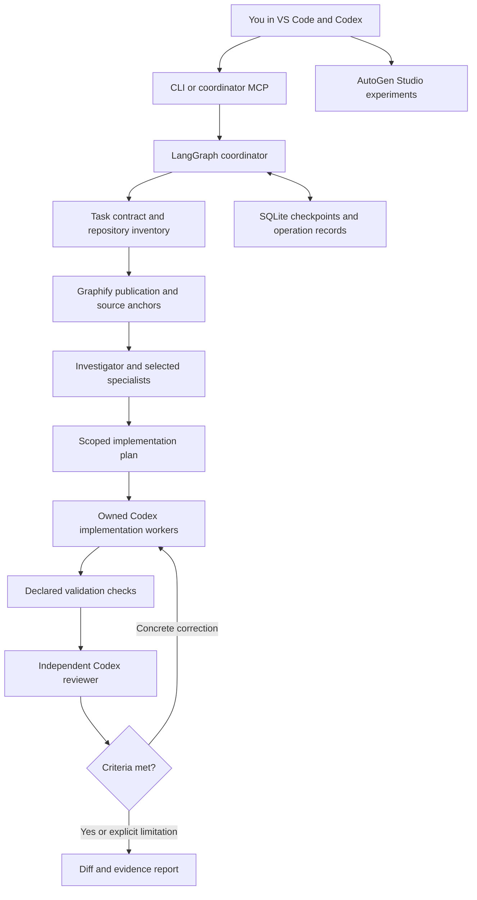

# Engineering automation architecture

This system adds durable coordination to the existing VS Code and Codex workflow. Codex performs engineering work; LangGraph stores and sequences that work. Graphify supplies repository navigation and provenance. AutoGen Studio supports separate team experiments.

The source of the engineering procedure remains [the workspace workflow](../../.codex/workflows/engineering.md). This document explains the executable system, rather than changing task authorization.

## Components and boundaries

| Component | Responsibility | Evidence boundary |
|---|---|---|
| CLI and VS Code tasks | Validate requests and expose job lifecycle commands | Starting a job does not mean it completed |
| Coordinator | Bound concurrency, sequence stages, collect worker output, and resume durable state | A checkpoint does not make filesystem edits transactional |
| Codex SDK worker | Execute an assigned role with model and native permission configuration | Effective configuration must be probed; declarations alone are insufficient |
| Repository manager | Resolve Git roots/checkouts, retain baselines, and track ownership | Path scopes describe ownership and detect changes; they are not OS path isolation |
| Graphify adapter | Resolve `LATEST.md`, perform bounded traversal, preserve confidence and source anchors | Graph adjacency and a publication date are not current runtime proof |
| Validation runner | Execute selected catalog commands and capture actual results | Exit code zero can coexist with skipped tests |
| Reviewer | Compare acceptance criteria with resulting source and evidence | Review applies to the inspected source state |
| Reports | Keep requested outcome, changes, checks, findings, and unresolved limitations together | An incomplete or blocked report is a valid record, not a successful outcome |

## Roles

The canonical prompts live in [`.codex/agents`](../../.codex/agents). All six request `gpt-6-astra` with `ultra` reasoning. The runtime must report incompatibility rather than silently substituting a model.

- **Investigator:** current source, graph relationships, affected repositories, impact, and selected checks.
- **Implementer:** scoped changes and meaningful regression coverage in its assigned checkout.
- **Reviewer:** independent acceptance and defect review against resulting source.
- **Oracle specialist:** SQL/Liquibase variants, transaction effects, rollback, callers, and runtime unknowns.
- **UI specialist:** exact frontend application and framework, state, permissions, inputs, and observable behavior.
- **Integration specialist:** APIs, EDI, replay/duplicates, commit/archive boundaries, and older consumers.

Specialists investigate by default. Implementation ownership is explicit. Workers do not recursively delegate, launch another engineering coordinator, or create independent write scopes. Four workers are the default capacity, with lower or higher limits available through the validated task field.

Current native custom-agent files use `name`, `description`, and `developer_instructions`, with ordinary Codex configuration keys for model, effort, and sandbox. Native discovery and SDK prompt loading are distinct mechanisms. Parent permission overrides can affect native agents, so a read-only TOML setting alone does not prove effective isolation. [Official custom-agent documentation](https://learn.chatgpt.com/docs/agent-configuration/subagents)

## Repository ownership

Setup generates the registry from the destination and discovered nested Git roots. Read its IDs and relative paths before creating a task. Each registered repository has separate Git state; a non-Git umbrella directory is not an implementation repository.

One physical checkout has one implementation owner at a time. Different path spellings, case, or junctions must not create two ownership identities for the same checkout. Read-only investigation can run concurrently, but its source fingerprints identify the state it actually examined.

Implementers run in repository order by default. A task can supply ordered `implementation_groups` for independent batches; concurrency requires explicit disjoint alternate checkouts. Later groups integrate against the preceding results. The grouping records the maintainer's dependency decision rather than inferring independence from repository names.

An outer-workspace worktree does not automatically isolate embedded repositories. Bind any prepared alternate repository checkout explicitly in the task's `checkouts` mapping. Validate its origin/base, instructions, tool prerequisites, and sibling layout before execution. Existing working files are the baseline when the task uses the current checkout; they must not be silently replaced with HEAD.

## Evidence and validation

Graph evidence records the selected publication, executed terms/traversal, matched nodes and relationships, limits, and source anchors. `EXTRACTED`, `INFERRED`, and `AMBIGUOUS` labels retain their meanings. Source verification remains a worker responsibility; missing edges do not prove missing dependencies.

The validation catalog is intentionally explicit. Each entry has a repository, working directory, argument vector, effect description, and result interpretation. Adding a build command requires inspecting what it invokes, including inherited Maven plugins and Ant dependencies. Operational actions such as migrations, deployment, signing, and real EDI transmission are outside the default catalog.

Checks and review refer to broader checkout source fingerprints, independently of the narrower permitted write scope. Tracked/nonignored dependency source, configuration, explicitly scoped ignored files, Git state and the validation catalog are part of evidence freshness. Declared generated/runtime/installed-package/nested-repository exclusions stay visible; external services and unselected repositories require separate evidence. Later changes to represented source invalidate previous results. Worker results are validated against a strict schema, including finding severity and exact acceptance-criterion identity; malformed results cannot become completion.

## Persistence and recovery

Local run state lives under `.engineering-state/`. It contains the task contract, worker/operation identifiers, check results, evidence, and reports; it is excluded from version control. Retain run records needed for diagnosis. Do not store credentials or real client payloads in them.

Checkout ownership uses a separate canonical account-local lease authority so supported runs with different state directories still coordinate. Uncertain operations retain their leases until explicit reconciliation using the original journal. Settle old-version runners before upgrading, and preserve both journals and shared lease data during recovery. Native approval identities include request type, thread and turn so a retried operation cannot inherit an expired request.

An interrupted workflow node can run again after resumption. Consequently, every consequential worker operation must first be reconciled with its existing process/session and filesystem. Unknown execution state remains visible. A retry must never create a second writer simply because a checkpoint is available. [LangGraph persistence](https://docs.langchain.com/oss/python/langgraph/persistence), [interrupt/resume behavior](https://docs.langchain.com/oss/python/langgraph/interrupts)

## Configuration ownership

Global Codex settings remain personal defaults. Project settings describe workspace integration. `AGENTS.md` routes instructions, `.codex/workflows/engineering.md` defines the procedure, and existing hooks remain owned by the destination project. The kit does not install or copy lifecycle hooks. Run records are evidence for one task; reviewed durable findings belong in project documentation.

`config/tools.yaml` is a capability inventory, not an implicit enablement or permission mechanism. The SDK runtime and the loaded IDE/MCP projects determine actual availability. AutoGen clients have their own provider configuration and do not inherit Codex authentication, skills, sandboxing, or Astra Ultra settings.

## Graph maintenance

Default setup reuses a compatible Graphify installation or installs the pinned package in a dedicated project environment. It preserves and consults an existing publication; when none exists it prepares a real code-only AST graph with source provenance and repository identities. Preparation requires explicit source scope for large projects and does not call semantic providers or install hooks. The kit never copies another project's graph or fabricates evidence. Newly installed tooling may be absent from an older graph. Record coverage limits and verify consequential findings against source. When graph preparation is unavailable, graph-dependent runs stay blocked unless the task has an explicitly authorized `graph_exception`.
